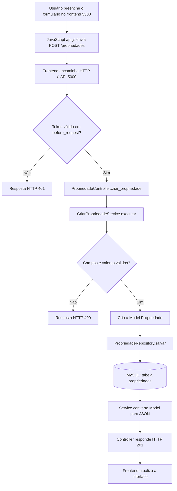
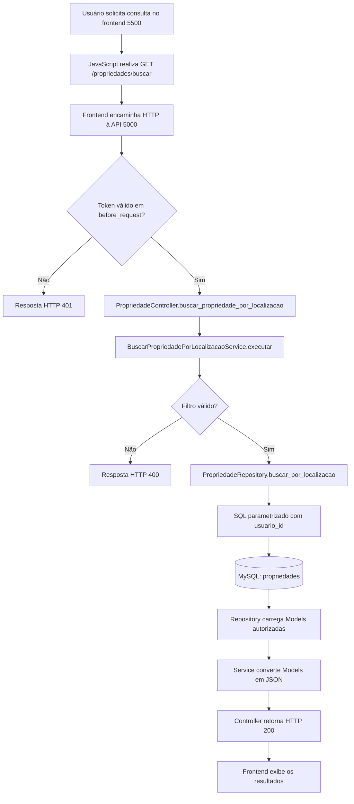
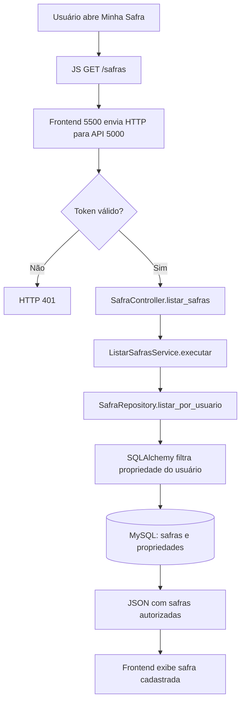

# Fluxogramas reais dos casos de uso — AgroRisk

Esses fluxos correspondem às rotas e às classes do projeto desta versão. As setas mostram **requisições HTTP** e chamadas entre **Controller → Service → Repository → Model/SQL**. Use-os na apresentação da rubrica.

## Fluxo 1 — Entrada de dados (cadastro de propriedade)

**Caso de uso:** usuário autenticado cadastra uma propriedade com nome, cidade, estado, área e localização. A interface envia `POST /propriedades`.

**Evidências:** `backend/controllers/propriedade_controller.py`, `backend/services/criar_propriedade_service.py`, `backend/repositories/propriedade_repository.py`, `backend/models/propriedade.py`, `backend/static/js/api.js`.

## Fluxo 2 — Recuperação de dados (consulta de propriedades por localização)

**Caso de uso:** usuário autenticado busca propriedades da própria conta por cidade, estado ou nome. A interface pode chamar `GET /propriedades/buscar?localizacao=...`.

**Evidências:** `backend/controllers/propriedade_controller.py`, `backend/services/buscar_propriedade_por_localizacao_service.py`, `backend/repositories/propriedade_repository.py`.

**Observação:** o endpoint de busca existe e pode ser testado com a API; verifique se a interface específica apresenta esse filtro antes de afirmar que está exposto como pesquisa de localização na tela. Para demonstração visual, a listagem por usuário é outro fluxo de recuperação implementado em `ListarPropriedadesService` e `PropriedadeRepository.listar_por_usuario`.

## Fluxo 3 — Recuperação de dados (listagem de safras)

## Cuidados ao apresentar

- As telas são entregues pelo servidor frontend, mas quem valida tokens e acessa o banco é a API.
- Repositories são responsáveis pelas consultas SQL/ORM; Models representam o domínio.
- Mostre os dois terminais executando em portas **5500 e 5000**, a chamada via navegador (Network) e a estrutura de diretórios.
- Não mostre senhas, tokens ou chaves reais.
