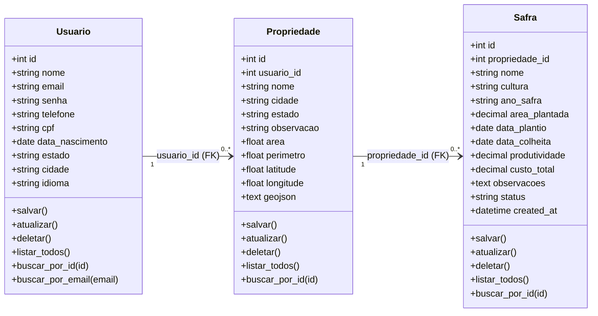

# Diagrama de classes — AgroRisk

Este diagrama apresenta as **Models de domínio** da versão Flask analisada: `Usuario`, `Propriedade` e `Safra`. As relações representam **chaves estrangeiras**, não composição de objetos implementada explicitamente no código. O GitHub renderiza o gráfico abaixo com Mermaid.

## Correspondência no código

| Classe | Arquivo | Tabela MySQL | Relação |
| --- | --- | --- | --- |
| `Usuario` | `backend/models/usuario.py` | `usuarios` | Identificado por `id` |
| `Propriedade` | `backend/models/propriedade.py` | `propriedades` | `usuario_id` referencia `usuarios.id` |
| `Safra` | `backend/models/safra.py` | `safras` | `propriedade_id` referencia `propriedades.id` |

A herança de `db.Model` está presente nas três classes, embora não esteja desenhada como uma entidade de domínio, porque faz parte da infraestrutura do SQLAlchemy.

**Nota de coerência:** os campos `produtividade` e `custo_total` permanecem na Model por compatibilidade com o banco, mesmo que previsões de produtividade e lucro tenham sido retiradas das telas e relatórios.
